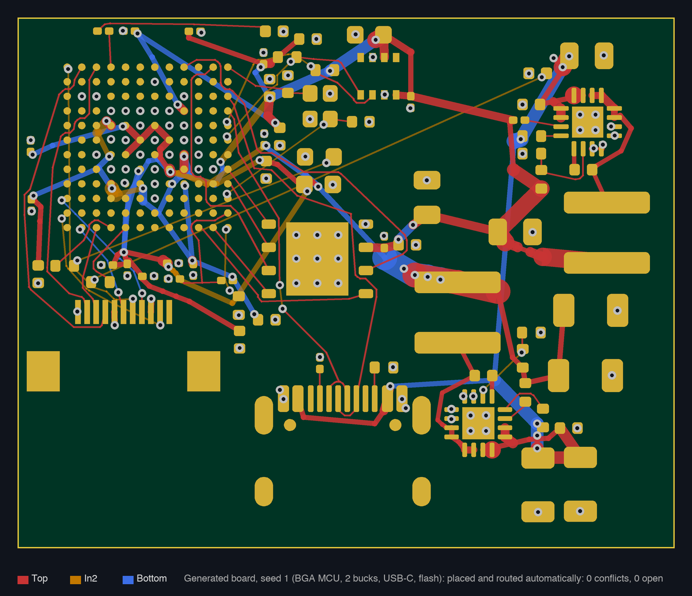
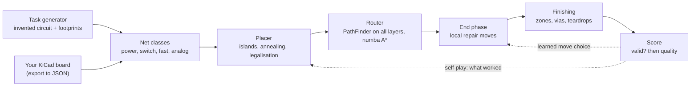

# Open Auto Router

**An open-source placer and autorouter for KiCad that learns by playing against boards it invents itself.**

[](https://github.com/semmelrinde/OpenAutoRouter/actions/workflows/ci.yml)
[](LICENSE)


[](https://github.com/semmelrinde/OpenAutoRouter/labels/good%20first%20issue)

<p align="center">
  
</p>

Autorouters have a bad reputation: they connect every net, but the result does not look like a board a good engineer
would ship. Open Auto Router tries to close that gap. It does not only route, it also **places** the parts, it knows
which nets carry current, which are switching nodes and which are fast signals, and it keeps improving itself on an
endless supply of generated boards, so nobody has to hand over private designs to train it.

> **Status: research code, looking for co-authors.** It places and routes generated 4 to 8 layer boards with BGAs,
> buck converters and fast buses, and it has already been used on real KiCad boards. It is not a polished product yet. If
> you have ever wished KiCad had a serious autorouter, this is the place to help build it.

## Try it with one command

No board of your own needed. The generator invents a plausible circuit (MCU or BGA processor, regulators, sensors,
flash, connectors) from the KiCad footprint library, then the tool chain places, routes and scores it:

```bash
git clone https://github.com/semmelrinde/OpenAutoRouter.git && cd OpenAutoRouter
python3.12 -m venv .venv && .venv/bin/pip install numpy scipy shapely numba pillow   # core; requirements.txt has the learning extras
.venv/bin/python learning/demo.py /tmp/oar seed=1
```

A 4-layer board with 60 to 80 parts takes about two to four minutes on a laptop (Apple M-series; seeds 1 and 2 both
come out valid). You get preview images of the placement (`pl_*.png`) and of every routed layer (`rt_*.png`) in `/tmp/oar/task_000001/`, and a summary line:
valid or not, clearance conflicts, open connections, score. Change `seed=` for another board, `n=10` for ten boards in a
row, `cu_layers=6` or `level=1` for harder ones. Same seed and same setup, same result.

## Why it is different

| | Classic autorouters (e.g. Freerouting) | Open Auto Router |
|---|---|---|
| Placement | you place, it routes | places and routes (islands around each chip, decoupling next to its pin) |
| Electrical intent | net classes and widths you set by hand | classifies nets itself: power, switch node, fast, analog, ground; estimates currents and sizes copper |
| Hard spots | rip-up and retry | negotiated congestion (PathFinder) plus a learned **end phase** of local repair moves |
| Training data | none | self-play on generated boards: unlimited, reproducible, nothing private |
| Copper zones | separate step | current-aware zones, stitching vias, teardrops, short-circuit guard |

## How it works



| Part | Where | What it does |
|---|---|---|
| Rules | `analysis/design_rules.py` | Reads design rules from a KiCad project (`.kicad_pro`, `.kicad_dru`) |
| Net classes | `analysis/netclasses.py` | Classifies nets, estimates currents from the circuit, builds component islands |
| Placer | `placement/placer.py` | Island-based global placement, refinement and legalisation (`mode=new` or `mode=refine`) |
| Router | `router/pf_*.py` → `router/route_pf.py` | Grid PathFinder (negotiated congestion), numba A*, exact clearance checks against KiCad geometry, pin access, current-aware widths, differential pairs, length matching |
| End phase | `router/pf_main.py` (`move=1`) | **Repair moves**: for the last conflicts, rip up a small neighbourhood and re-route it with a strategy; keep the move if the spot improves. Every move is logged with features for learning |
| Learning | `learning/` | Task generator (`learning/tasks.py`), self-play (`learning/selfplay.py`), Thompson-sampling bandit over settings, learned move choice (`learning/move_choice.py`) |
| Post-processing | `postprocessing/` | Shortcuts, teardrops, zones, stitching vias, short-circuit guard |
| Scoring | `analysis/evaluation.py` | Hard gates first (valid, open, conflicts), then a quality score; preview images by net kind |
| KiCad bridge | `kicad/` | Export a board to JSON, import routes back, DRC via `kicad-cli` |

## Your own KiCad board

`kicad/export_board.py` (run with KiCad's Python) → `analysis/design_rules.py` / `analysis/netclasses.py` → placer → router →
`finish.sh` writes a new `.kicad_pcb` next to (never over) your project. **Always work on a copy of your board.**
The main scripts start with a docstring that explains every option.

## Help wanted

There is something for every background. Details in [CONTRIBUTING.md](CONTRIBUTING.md), small tasks under
[good first issues](https://github.com/semmelrinde/OpenAutoRouter/labels/good%20first%20issue).

- **You lay out boards by hand?** Run the demo and tell us, with a picture, what a human would have done differently.
  Expert judgement is the scarcest input of a learning router.
- **You like algorithms?** New repair moves (shift a small part by 0.2 mm, swap layers, merge vias), faster A*,
  smarter placement cost.
- **You do ML / RL?** Every attempt and every repair move is logged with features. The move choice and the self-play
  bandit are deliberately simple and waiting for better policies.
- **You found a case where the internal check says "valid" but KiCad DRC disagrees?** A failing seed plus a fix is gold.
- **You have a fast machine?** Run many seeds and post valid boards per CPU hour in
  [Discussions](https://github.com/semmelrinde/OpenAutoRouter/discussions).

Two rules: results must be reproducible (same input and seed, same file), and **never commit board files** you are not
allowed to share. Generated tasks are enough for almost everything.

## Requirements

- macOS or Linux, Python 3.12
- KiCad 10: its footprint library feeds the generator (set `KICAD_FOOTPRINTS=` if it is not in the default macOS
  place), its Python runs the `pcbnew` steps in `kicad/`
- Placer, router and demo need only numpy, scipy, shapely, numba and pillow; `requirements.txt` adds the learning
  extras (torch, lightgbm, optuna, …; `mlx` is macOS only)

## Language

The project was originally written in German. This repository is generated from it and translated to English
automatically, so names stay consistent between releases. Code comments are not included; the main entry points have
English docstrings. Pull requests are welcome here and are ported back with your authorship credited (see
[CONTRIBUTING.md](CONTRIBUTING.md)).

## License

GPL-3.0-or-later, see [LICENSE](LICENSE).
